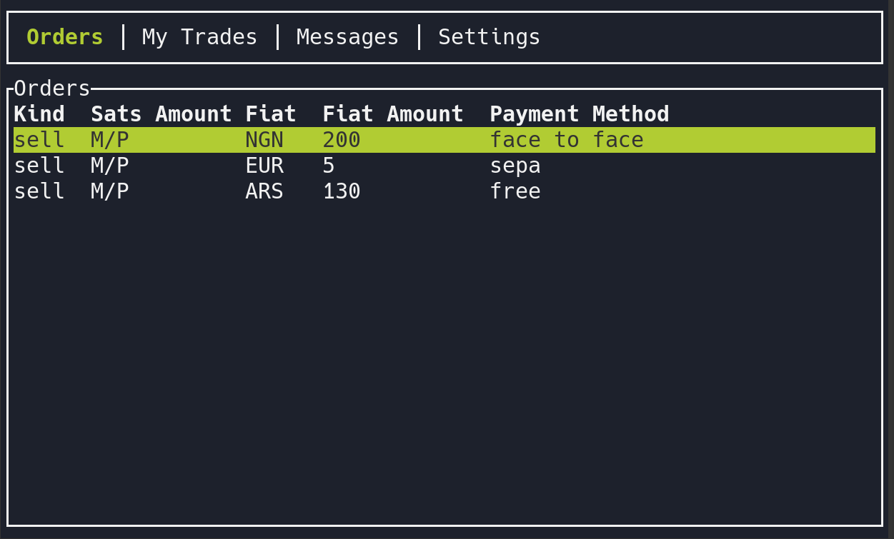

# MostriX

MostriX es un cliente de Mostro con interfaz TUI (Terminal User Interface). Tiene dos modos:

- **Modo usuario**, para operar: libro de órdenes con filtros y orden, crear y tomar órdenes, chat con tu contraparte, cancelación cooperativa, calificación y disputas con el solver.
- **Modo administrador**, para solvers de disputas y operadores de nodos: tomar disputas, chatear con ambas partes, liquidar o cancelar, confiscar [depósitos anti-abuso](./anti-abuse-bond.md) y registrar solvers.



> **Nota:** MostriX sigue evolucionando. Si encuentras un bug, por favor repórtalo.

## Instalación

Hay binarios precompilados para Linux, macOS, FreeBSD y Windows en [GitHub Releases](https://github.com/MostroP2P/mostrix/releases). Las releases están firmadas: importa las claves de los mantenedores desde la carpeta `keys/` del repositorio, verifica `manifest.txt` con `gpg --verify manifest.txt.sig.arkanoider manifest.txt` y luego el hash del binario:

```bash
sed 's#  artifact-[^/]*/#  #' manifest.txt | sha256sum -c --ignore-missing
# macOS: reemplaza sha256sum -c por shasum -a 256 -c
```

O compílalo desde el código fuente (requiere Rust 1.97 o superior):

```bash
git clone https://github.com/MostroP2P/mostrix.git
cd mostrix
cargo run --release
```

## Características

- Libro de órdenes con filtros y orden
- Crear órdenes de compra y venta, incluidas órdenes de rango y órdenes de privacidad total
- Tomar órdenes (compra y venta), con tu Lightning Address
- Confirmar fiat enviado y liberar sats
- Agregar una nueva invoice si el pago falla
- Chat cifrado de extremo a extremo con tu contraparte, con archivos adjuntos
- Cancelación cooperativa y calificación
- Abrir una disputa y chatear con el solver; compartir con él la clave del chat de la operación
- Tu propia reputación en la barra de estado
- Restaurar tu sesión desde el nodo
- Generación automática de semilla de 12 palabras y gestión de llaves según el protocolo Mostro
- Modo administrador para solvers: tomar disputas, chatear con ambas partes, liquidar, cancelar y confiscar depósitos, leer los reportes de [Serbero](./disputes.md#serbero-el-asistente-automático) y recibir alertas por Telegram mediante mostro-watchdog

MostriX habla solo el protocolo v2 de Mostro (desde la versión 0.3.1). Todavía no admite [importar tu reputación](./reputation-import.md).

## Configuración

En la primera ejecución, MostriX crea `~/.mostrix/` con tu nueva semilla de 12 palabras y un archivo `settings.toml`, y te muestra las 12 palabras: anótalas. La mayoría de las opciones se pueden cambiar desde la pestaña **Settings** (presiona Shift+H allí para ver la ayuda de cada una).

Parámetros principales de `settings.toml`:

- `mostro_pubkey`: clave pública del nodo de Mostro (o **Settings → Select Mostro Instance**)
- `nsec_privkey`: tu identidad de trader, derivada de la semilla; no la edites
- `relays`: lista de relays a los que conectarse
- `currencies_filter`: monedas a mostrar; vacío muestra todas
- `user_mode`: `user` o `admin` (o **Settings → Switch Mode**)
- `ln_address`: tu Lightning Address
- `admin_privkey`: para solvers, la clave registrada como solver en el nodo; para el operador del nodo, la clave privada del propio daemon de Mostro (la que corresponde a `mostro_pubkey`), necesaria para agregar solvers

Usa las flechas para moverte entre pestañas, Ctrl+H para la ayuda contextual y la pestaña **Exit** para salir.

## Más información

MostriX es un proyecto FOSS. Puedes visitar su [repositorio en GitHub](https://github.com/MostroP2P/mostrix) para conocer más sobre su desarrollo, reportar bugs o proponer mejoras. Los operadores de nodos pueden encontrar más sobre su modo administrador en la [guía para correr un nodo de Mostro](https://mostro.community/guide).
