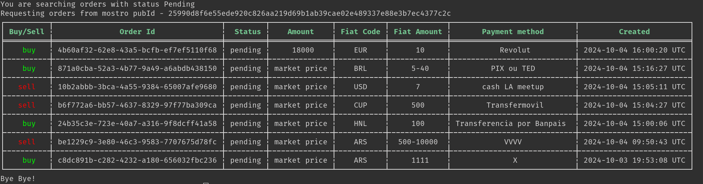

# Mostro CLI

Mostro CLI es un cliente de Mostro con interfaz de línea de comandos. Es utilizado principalmente por desarrolladores y usuarios avanzados para probar las últimas funcionalidades de Mostro y para automatizar operaciones.



## Instalación

Puedes instalar Mostro CLI directamente desde crates.io:

```bash
cargo install mostro-cli
```

O compilarlo manualmente:

```bash
git clone https://github.com/MostroP2P/mostro-cli.git
cd mostro-cli
cargo build --release
```

Requisitos: Rust 1.97 o superior. En Debian/Ubuntu también necesitas `sudo apt install -y cmake build-essential pkg-config libssl-dev`.

También hay binarios precompilados para Linux, FreeBSD y Windows en [GitHub Releases](https://github.com/MostroP2P/mostro-cli/releases) (no hay binario para macOS; usa `cargo install`). Verifica la descarga con el `manifest.txt` de la release:

```bash
sed 's#  artifact-[^/]*/#  #' manifest.txt | sha256sum -c --ignore-missing
```

## Características

- Crear órdenes de compra y venta
- Tomar órdenes del libro de ofertas
- Soporte para órdenes de rango (min-max)
- Crear órdenes de compra con Lightning Address
- Chat con tu contraparte (protocolo v2 de Mostro, cifrado con NIP-44)
- Gestión de identidad a partir de una frase de 12 palabras (NIP-06), guardada en `~/.mcli/mcli.db`: haz backup de ella
- Flujo completo de disputas, incluido el chat con el solver (`disputechat`)
- Reclamar tu parte de un [depósito anti-abuso](./anti-abuse-bond.md) confiscado (`addbondinvoice`)
- Restaurar tu identidad y listar las órdenes y disputas que Mostro guarda para ti (`restore`)
- Comandos de administración para operadores y solvers de Mostro

Mostro CLI habla solo el protocolo v2 (desde la versión 0.16.2), como los nodos de Mostro actuales. Todavía no admite [importar tu reputación](./reputation-import.md), y solo puede crear órdenes de [monedas estables y bitcoin en otras redes](./stablecoins.md) a precio fijo.

## Uso básico

```bash
# Configurar variables de entorno (reemplaza las variables a tu conveniencia)
export MOSTRO_PUBKEY=<el npub del nodo de Mostro que quieres usar>
export RELAYS='wss://relay.mostro.network,wss://mostro-p2p.tech'

# Listar órdenes disponibles
mostro-cli listorders

# Crear una orden de compra
mostro-cli neworder -k buy -c ves -f 1000 -m "face to face"

# Crear una orden de venta con rango
mostro-cli neworder -k sell -c ars -f 1000-10000 -m "transferencia bancaria"

# Cancelar una orden pendiente
mostro-cli cancel -o <order-id>

# Restaurar sesión
mostro-cli restore
```

Mostro CLI no lee ningún archivo de configuración: define el nodo y los relays en el entorno, y pon los flags globales (`-m`, `-r`, `-p`, `-t`, `-v`) antes del comando. No se mantiene conectado, así que ejecuta `mostro-cli getdm` después de cada paso para ver las respuestas de Mostro.

Para ver todos los comandos disponibles:

```bash
mostro-cli help
```

## Más información

Mostro CLI es un proyecto FOSS. Puedes visitar su [repositorio en GitHub](https://github.com/MostroP2P/mostro-cli) para conocer más sobre su desarrollo, reportar bugs o proponer mejoras.
