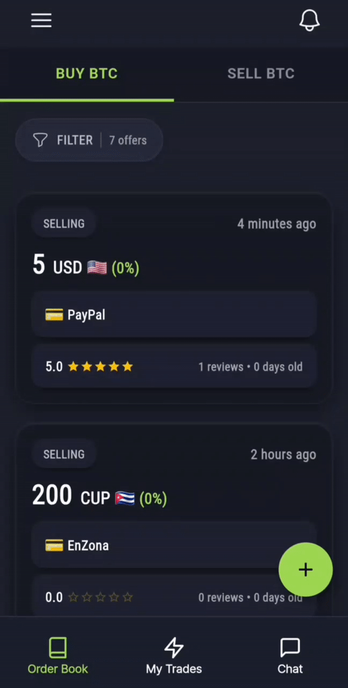

# Mostro Mobile

[Mostro App](https://github.com/MostroP2P/app) es la aplicación oficial para usar Mostro. Está disponible para Android, Windows, macOS, Linux y la web, y próximamente para iOS.

## Descargas

- Android: [GitHub Releases](https://github.com/MostroP2P/app/releases/latest) o [Zapstore](https://zapstore.dev/apps/foundation.mostro.app)
- Windows, macOS y Linux: [GitHub Releases](https://github.com/MostroP2P/app/releases/latest)
- Web: [mostro.network/app](https://mostro.network/app/)
- iOS: Próximamente

## Características principales

### Gestión de identidad

- Creación automática de cuenta con frase de 12 palabras
- Backup de identidad
- Restauración de cuenta en cualquier dispositivo
- Recuperación de trades activos al restaurar (solo en modo reputación)

### Trading

- Crear órdenes de compra y venta
- Tomar órdenes del libro de ofertas
- Filtro por moneda fiat
- Soporte para órdenes con precio fijo o precio de mercado
- Soporte para premium/descuento sobre precio de mercado

### Lightning Address
- Configura tu Lightning Address en la app
- Al comprar sats, la app usa automáticamente tu Lightning Address
- No necesitas generar invoices manualmente

### Comunicación

- Chat cifrado de extremo a extremo con tu contraparte
- Chat con el solver durante disputas
- Los mensajes no pueden ser borrados ni alterados

### Notificaciones

- Notificaciones push para actividad en tus trades
- Importante mantenerlas activas para no perder el timing de una operación
- Configurables desde los ajustes de la app

### Disputas

- Abrir disputas directamente desde la app
- Comunicación con el solver
- Compartir evidencia del chat si es necesario

### Multi-idioma

- Disponible en español, inglés e italiano

### Múltiples nodos

- Soporte para conectarse a diferentes nodos de Mostro
- Cambiar entre nodos desde la configuración

## Primeros pasos

1. Descarga la app desde las fuentes oficiales
2. Al abrir por primera vez, se creará tu identidad automáticamente
3. Haz backup de tus 12 palabras antes de operar
4. Configura tu Lightning Address (opcional pero recomendado)
5. Activa las notificaciones push
6. Listo para comerciar

## Más información

- Repositorio: [https://github.com/MostroP2P/app](https://github.com/MostroP2P/app)
- Reportar bugs: [GitHub Issues](https://github.com/MostroP2P/app/issues)
