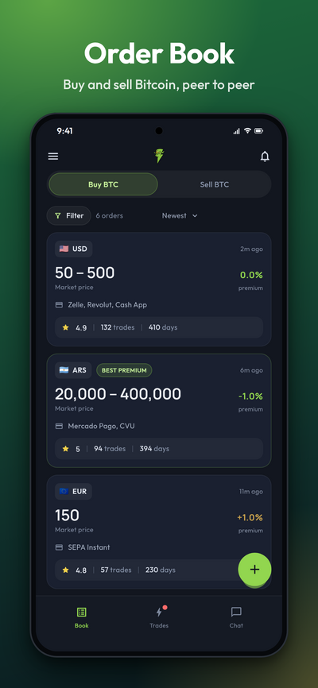

# Mostro App

[Mostro App](https://github.com/MostroP2P/app) es la aplicación oficial para usar Mostro. Está disponible para Android, iOS, Windows, macOS, Linux y la web. Todavía está en beta: verás una etiqueta *Beta* en su menú.

## Descargas

- **Android** (7.0 o posterior): [Zapstore](https://zapstore.dev/apps/foundation.mostro.app) o el APK en [GitHub Releases](https://github.com/MostroP2P/app/releases/latest) (`arm64-v8a` para casi cualquier teléfono, `armeabi-v7a` para los antiguos de 32 bits).
- **iOS** (14 o posterior): todavía no hay versión en la App Store. La release incluye un archivo `.ipa` que puedes instalar con AltStore, Sideloadly o Xcode. Las instalaciones firmadas con un Apple ID gratuito caducan a los 7 días, y en ellas las notificaciones push no funcionan.
- **Windows, macOS y Linux**: [GitHub Releases](https://github.com/MostroP2P/app/releases/latest). Los builds todavía no están firmados por Apple ni por Microsoft, así que el primer arranque requiere un paso extra (en Windows, *Más información → Ejecutar de todas formas*; en macOS, quita la marca de cuarentena como explican las notas de la release).
- **Web**: [mostro.network/app](https://mostro.network/app/). Siempre ejecuta el build de desarrollo más reciente, y puedes instalarla como app desde el navegador.

Cada release incluye un archivo `SHA256SUMS.txt` para verificar tu descarga. Descarga solo desde estas fuentes oficiales.

La nueva app reemplaza a la antigua *Mostro Mobile* (versión 1), y ambas pueden instalarse lado a lado. Para pasarte, termina tus operaciones abiertas en la app antigua e importa tus 12 palabras en la nueva (consulta [Backup y Restauración de Cuenta](./backup-restore.md)).

## Primeros pasos

1. Descarga la app desde una fuente oficial.
2. Al abrirla por primera vez, tu identidad se crea automáticamente. Un breve recorrido explica cómo funciona Mostro.
3. Elige el nodo de Mostro en el que quieres operar (**Usar este nodo**), u omite este paso para usar el predeterminado.
4. Haz backup de tus 12 palabras antes de operar: *Cuenta → Palabras secretas → Mostrar palabras*.
5. Configura tu Lightning Address o conecta una billetera con NWC (opcional pero recomendado).
6. Mantén activadas las notificaciones push.
7. Listo para operar.

## Características principales

### Identidad y privacidad

- Creación automática de cuenta con frase de 12 palabras
- Backup guiado y restauración de cuenta en cualquier dispositivo (*Cuenta → Importar usuario de Mostro*)
- Recuperación de operaciones activas al restaurar, por nodo (solo en modo de reputación)
- [Modo de reputación o modo de privacidad total](./privacy.md), en *Cuenta → Privacidad*
- Tu propia reputación en el nodo que usas, en *Cuenta*
- [Importa tu reputación](./reputation-import.md) desde @lnp2pBot u otro nodo de Mostro, en *Configuración → Red → Reputación*

### Trading

- Libro de órdenes con las pestañas **Comprar BTC** y **Vender BTC**, filtros (moneda, método de pago, calificación, prima) y orden (más recientes, mejor prima, mejor reputación)
- Crear órdenes de compra y venta, con monto fijo o con rango
- Precio de mercado con prima o descuento, o precio fijo
- Solo se ofrecen las monedas que acepta el nodo, incluidas las [monedas estables y el bitcoin en otras redes](./stablecoins.md) donde el nodo las habilita
- Tomar órdenes; en las órdenes de rango ingresas el monto
- Compartir una orden como enlace o código QR
- [Depósito anti-abuso](./anti-abuse-bond.md) en los nodos que lo usan, y **Reclama tu parte** si tu contraparte pierde el suyo
- Cuenta regresiva para cada paso de la operación
- **Mis operaciones** agrupa tus operaciones en "Requieren tu acción", "En curso" y "Cerradas"

### Pagos

- **Lightning Address** (*Configuración → Pagos*): cuando tomas una orden de venta, tus sats van a ella por defecto, y aún puedes elegir otra dirección o una invoice para esa operación. En tus propias órdenes de compra, la pantalla de la invoice se rellena con ella y solo confirmas.
- **Nostr Wallet Connect (NWC)** (*Configuración → Pagos → Billetera NWC*): conecta tu billetera para pagar hold invoices y depósitos con **Pagar con billetera**, y deja que cree tus invoices automáticamente. La cadena de conexión permanece en tu dispositivo.

### Comunicación

- Chat cifrado de extremo a extremo con tu contraparte, uno por operación
- Envío de fotos y archivos PDF cifrados en el chat
- Reaccionar a los mensajes y copiarlos; los mensajes no pueden ser borrados ni alterados
- El chat sigue abierto una hora después de que termina la operación, y luego queda de solo lectura

### Disputas

- Abre disputas directamente desde la pantalla de la operación; síguelas en *Chat → Disputas*
- Chatea con el solver y adjunta evidencia
- **Compartir la clave del chat con el resolutor** en un toque, solo para esa operación
- Los mensajes de [Serbero](./disputes.md#serbero-el-asistente-automático), el asistente automático que usan algunos nodos, se identifican como tales

### Notificaciones

- Notificaciones push para tus operaciones, mensajes, pagos y disputas, configurables una por una en *Configuración → Aplicación → Notificaciones push*
- Es importante mantenerlas activadas para no perder el timing de una operación
- Las notificaciones no llevan contenido: solo avisan a tu dispositivo de que hay algo para ver
- Las notificaciones push funcionan en Android y en las builds oficiales de iOS; las versiones de escritorio y web muestran notificaciones solo dentro de la app
- El ícono de campana también muestra anuncios firmados del proyecto Mostro

### Múltiples nodos

- Una lista de nodos comunitarios de confianza, con el estado, la tarifa y el depósito de cada uno (*Configuración → Red → Nodo Mostro*)
- Agrega tu propio nodo con su clave pública. Verifica la clave con el operador: un nodo falso puede ver tus órdenes.
- Una operación permanece en el nodo donde empezó; **Mis operaciones** muestra las operaciones del nodo que tienes seleccionado
- Sigues recibiendo notificaciones de las operaciones en otros nodos
- *Acerca de* muestra los límites, la tarifa, el depósito, las monedas, los tiempos y las fuentes de precio del nodo que usas

### Multi-idioma

- Disponible en español, inglés, francés, alemán, italiano, neerlandés y portugués

### Ayuda

- *Configuración → Ayuda → Informe de registros* te permite ver y compartir los registros de la app al reportar un problema
- *Acerca de → Guía de usuario* abre esta documentación

## Más información

- Repositorio: [https://github.com/MostroP2P/app](https://github.com/MostroP2P/app)
- Reportar bugs: [GitHub Issues](https://github.com/MostroP2P/app/issues)
